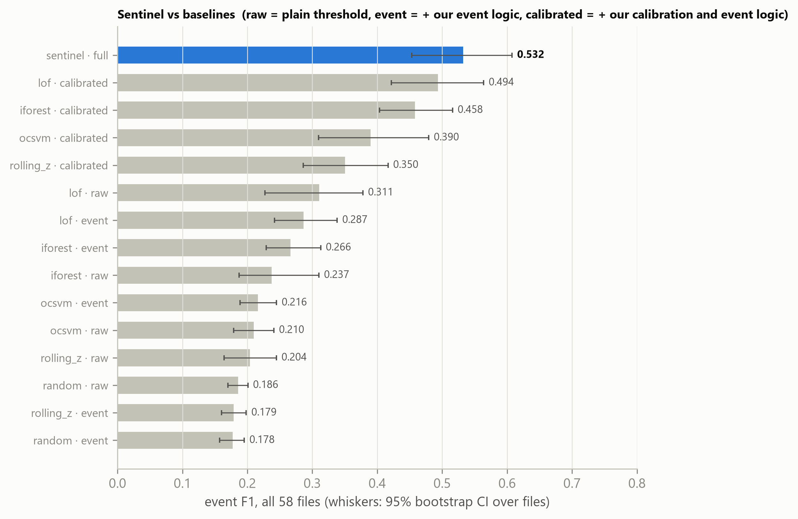
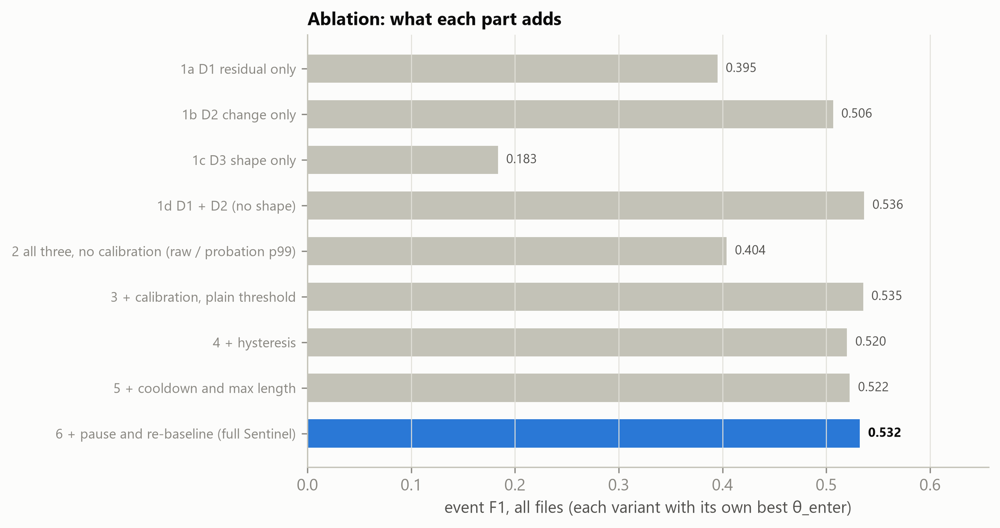
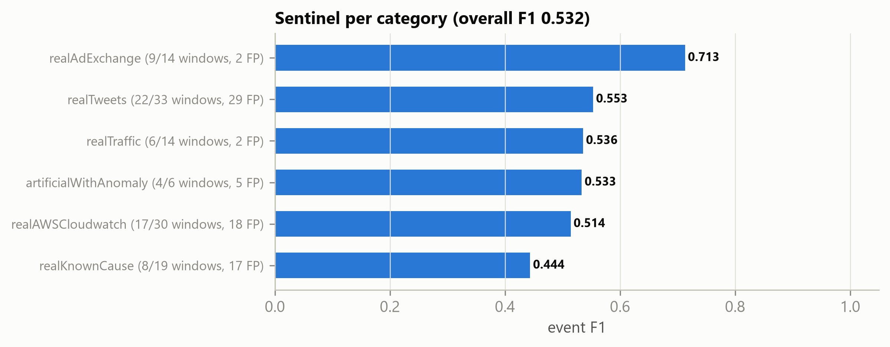
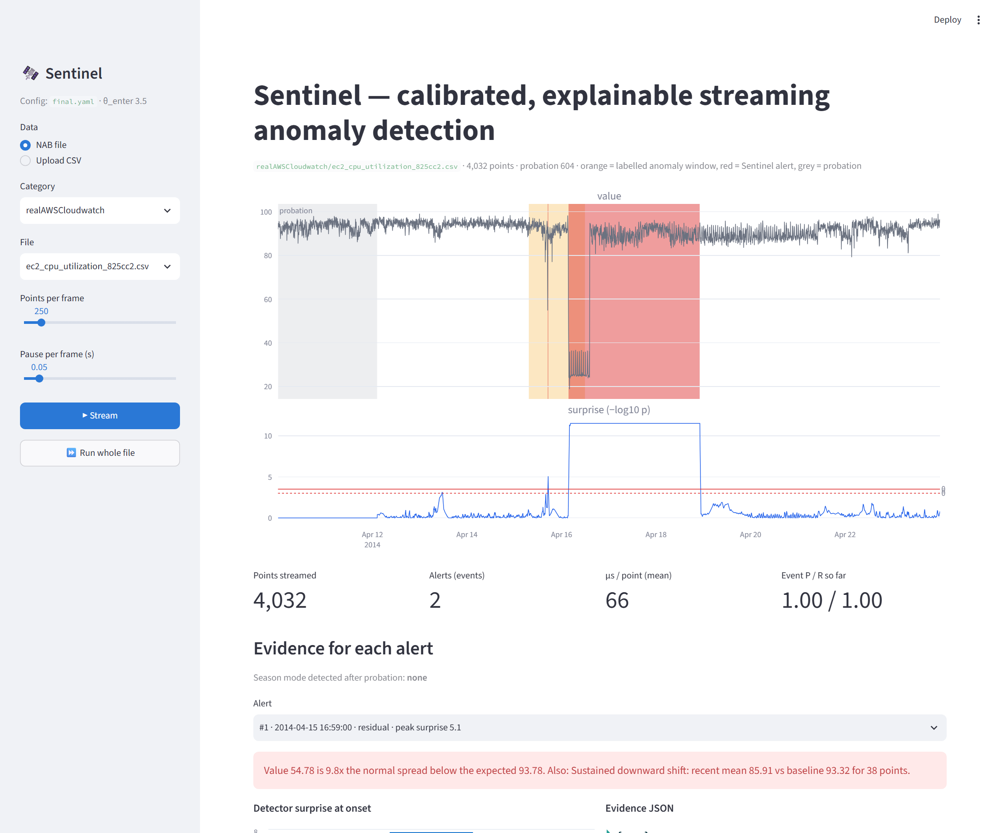

# Sentinel — calibrated, explainable streaming anomaly detection

**Utkrishta 2026 · Challenge 2 · Team TBD · Kommana Srinivasa Rao + Panuganti Bhanu + Vishnu Datta + Kumarran Mahesh**

Sentinel reads a univariate time series one point at a time and, for every point, returns an
anomaly score in [0, 1], a label (`NORMAL` / `ANOMALOUS`) and, for every alert, evidence that
says why. Three cheap detectors (spikes, shifts, odd shapes) are calibrated into one common
"surprise" scale, and an event state machine turns surprise into **one alert per incident**.

## Results (NAB, all 58 files, `configs/final.yaml`)

| Metric | Sentinel |
|---|---|
| **Event F1**, all files | **0.532** (95% bootstrap CI 0.453–0.607) |
| **Event F1, held-out categories** (LOCO over all 218 searched configs) | **0.486** |
| Precision / recall | 0.500 / 0.569 (66 of 116 windows found, 74 false alerts) |
| Alerts per detected window | 1.12 |
| Detection delay | median alert 1 point (5 min) after the labelled anomaly point; mean 18 points *before* it |
| Point-wise F1 | 0.220 |
| NAB score (standard profile) at our operating point | 40.7 |
| Runtime | **44 µs per point** mean (p50 37, p95 60, p99 243 µs); 15 s for all 365,558 points on one core |

Sentinel vs baselines (best variant of each; full table in `results/baselines_comparison.csv`):

| Method | Event F1 | LOCO-CV F1 | Precision | Recall | False alerts | µs / point |
|---|---|---|---|---|---|---|
| **Sentinel** | **0.532** | **0.486** | 0.500 | 0.569 | 74 | 44 |
| LOF + our calibration & event logic | 0.494 | 0.471 | 0.452 | 0.543 | 86 | 6,436 |
| Isolation Forest + our calibration & event logic | 0.458 | 0.458 | 0.347 | 0.672 | 188 | 4,899 |
| One-Class SVM + our calibration & event logic | 0.390 | 0.372 | 0.288 | 0.603 | 220 | 385 |
| Rolling z-score + our calibration & event logic | 0.350 | 0.350 | 0.299 | 0.422 | 131 | 12 |
| LOF, plain p99 threshold (as in PLAN) | 0.311 | – | 0.199 | 0.707 | 1,102 | 6,436 |
| Random scores, plain threshold | 0.186 | – | 0.103 | 0.931 | 4,301 | – |

µs / point for baselines = one scikit-learn scoring call per new point (`scripts/benchmark_runtime.py`);
the calibrated variants add about 10 µs.

Ablation (each variant with its own best θ_enter; `results/ablation.csv`):

| Variant | Event F1 | LOCO-CV F1 |
|---|---|---|
| D1 residual only / D2 change only / D3 shape only | 0.395 / 0.506 / 0.183 | 0.369 / 0.470 / 0.183 |
| D1 + D2 (no shape detector) | 0.536 | 0.520 |
| All three, **no calibration** (raw score / probation p99) | 0.404 | 0.348 |
| + calibration, plain threshold | 0.535 | 0.512 |
| + hysteresis / + cooldown & max length | 0.520 / 0.522 | 0.505 / 0.483 |
| + pause & re-baseline (**full Sentinel**) | 0.532 | 0.517 |



### What we learned (honest reading)

1. **Calibration is the main win.** Turning raw scores into tail p-values adds +0.13 F1 to Sentinel
   (0.404 → 0.535), and the same calibration lifts every baseline (LOF 0.311 → 0.494).
   Calibrated *random* scores raise zero alerts, as they should.
2. **The CUSUM change detector (D2) carries most of the signal**; D1 adds to it. The shape
   detector (D3) is noise-level on NAB (±0.004 F1 depending on another setting). The pre-registered
   selection rule keeps it because it makes per-category results more even; turning it off
   (`shape.enabled: false`) roughly halves the cost per point.
3. **Event logic is about alert quality, not F1.** At the tuned threshold a plain threshold scores the
   same F1 (0.535 vs 0.532). The state machine trades a little precision for recall (0.509 → 0.569)
   and cuts repeated alerts per incident from 1.32 to 1.12.
4. **The held-out number is lower** (0.486 vs 0.532): what is best on six categories transfers
   imperfectly to the seventh. That is the number to expect on new data.
5. **Tested and rejected on held-out evidence**: Fisher fusion, peak-or-mean smoothing, learning
   during cooldown, log1p transform, capped CUSUM (−0.11 F1), and feeding D2 deseasonalized values
   (fixes the synthetic daily files, 0.53 → 0.80, but hurts real seasonal ones: −0.02 overall).

<table><tr>
<td></td>
<td></td>
</tr></table>



## Quick start

```bash
git clone https://github.com/ksrinivasarao2012/sentinel.git
cd sentinel
python -m venv .venv
.venv\Scripts\activate            # Linux/macOS: source .venv/bin/activate
pip install -r requirements.txt
python scripts/download_nab.py    # NAB data + labels into data/raw/nab/
pytest -q
```

Run on the whole corpus and score it:

```bash
python scripts/run_detector.py --detector sentinel --config configs/final.yaml --out predictions/
python scripts/evaluate.py --pred predictions/ --out results/
```

Run on any `timestamp,value` CSV (for hidden test files):

```bash
python scripts/run_stream.py --input some_new_file.csv --output out.csv --events out_events.jsonl
```

Live demo:

```bash
streamlit run app/streamlit_app.py
```

## Environment

- Python 3.11.9, Windows 11, CPU only (Intel i7-1360P, 16 GB RAM). Linux/macOS work the same way.
- Exact package versions in `requirements.txt`. No GPU, no internet needed after the download.
- Data: NAB, github.com/numenta/NAB, commit `ea702d75cc2258d9d7dd35ca8e5e2539d71f3140`
  (58 files, 7 categories, 116 labelled windows, 365,558 points). `data/` is not committed;
  `scripts/download_nab.py` fetches it (shallow sparse clone; NAB's own code is read for the
  scoring rules but never run).
- Same data as Kaggle `boltzmannbrain/nab`: all 58 csv files have identical timestamps and
  values (only line endings differ). Kaggle ships no labels, so labels come from NAB GitHub;
  final.yaml on the Kaggle files gives the same F1 0.532.
  Check: `python scripts/compare_kaggle.py <unzipped Kaggle folder> --run`.
- No pretrained or fine-tuned model. Every detector starts empty on each file and learns
  "normal" online from that file's own first 15%, without labels. Labels are used only offline,
  to pick 8 global settings (the held-out LOCO number tests that choice).

## How it works

```
stream (timestamp, value)
   │  probation (first P points): buffer, then pick season mode + scale floor, replay once
   ▼
 D1 residual  : |x − (rolling median of deseasonalized x + hour-of-day/week offset)| / σ
 D2 change    : two-sided CUSUM on a slow baseline + a variance CUSUM
 D3 shape     : distance of the newest 32-point z-normalized window to its nearest past window
   ▼
 calibration  : each raw score → tail p-value vs that detector's recent NORMAL scores
                (empirical, + exponential tail fit beyond the 95th percentile) → U = −log10 p
 fusion       : U = max_k U_k − log10(3)   (Bonferroni), Ū = mean over the last w_s points
   ▼
 event logic  : NORMAL → ANOMALOUS when Ū ≥ θ_enter; stay while Ū ≥ θ_exit and length < L_max;
                then COOLDOWN c points. Learning pauses during an alert; after a lasting
                shift the detectors re-baseline.
   ▼
 output       : anomaly_score = 1 − 10^(−Ū), label, top detector, event id, state
                + one evidence record per alert (JSON + one sentence)
```

Why each part exists:

- **Three detectors** cover NAB's three anomaly types: point spikes/dips (D1), sustained level or
  variance changes (D2), and unusual patterns at normal amplitude (D3). All are O(1) or O(H·m) per point.
- **Calibration** makes the detectors comparable and makes θ mean the same thing on every series:
  Ū = 4 means "about 1 in 10,000 under recent normal behaviour". The tail fit lets surprise keep
  growing past the 1/(n+1) floor of an empirical p-value (peaks-over-threshold idea).
- **Event logic** is the precision lever: hysteresis keeps one incident as one event, the cooldown
  blocks repeat alerts on the aftermath, and pause + re-baseline stop endless alerts after a
  permanent shift.
- **Evidence**: at alert onset, each detector's numbers are frozen into a JSON record and one sentence,
  e.g. *"Value 3.92e+04 is 7.2x the normal spread above the expected 2.29e+04 (weekly pattern, Sun 01:00)."*

Every choice that differs from the original plan is listed in `PLAN.md` Section 20, and every
change is logged in `LOGBOOK.md`.

## Assumptions

| ID | Assumption |
|---|---|
| A1 | Data = standard NAB corpus (58 CSVs, `timestamp,value`) + NAB label files; other formats via `io.read_csv` column options. |
| A2 | Ground truth = NAB anomaly windows (`labels/combined_windows.json`). |
| A3 | Probation = first `min(floor(0.15·N), 750)` points (verified in NAB `nab/util.py`); no alerts there; windows overlapping probation dropped (NAB already does this). |
| A4 | The detector is told the probation length; unknown-length streams use 750 (`--unknown-length`). |
| A5 | Event F1 as defined below (primary). Point-wise F1 and NAB score also reported. |
| A6 | Delay measured from window start and from the labelled point. |
| A7 | Output format below; remap with `scripts/export_predictions.py --schema configs/export_schema.yaml`. |
| A8 | "Runtime per streaming window" = time for one `update()` call (score + label + evidence + learning). |
| A9 | Python 3.11, CPU only. |
| A10 | Team name and second member are placeholders. |

## Metrics

All counts are summed over files (micro average).

- **Event F1 (primary).** GT events = NAB windows (after probation, overlaps merged). Predicted events =
  maximal runs of `ANOMALOUS`. Recall = windows touched by ≥ 1 predicted event / windows.
  Precision = predicted events touching ≥ 1 window / predicted events. No point adjustment.
- **Point-wise F1**: every scored point is a sample, window points are positives.
- **NAB score** (standard profile), re-implemented from NAB's `sweeper.py`, scoring our alert
  onsets as detections. NAB's scoreboard optimizes a threshold per detector, so this is
  "NAB score at our operating point", not directly comparable to the scoreboard.
- **Delay**: first alert inside a detected window − window start (points, minutes, and as a
  fraction of the window); also relative to the labelled point (negative = early).
- **Runtime**: µs per `update()` (mean, p50, p95, p99), corpus seconds, machine spec.

## Experiment strategy

- **No per-file tuning**: one global config (`configs/final.yaml`).
- **Leave-one-category-out (LOCO)**: parameters are chosen on 6 categories and scored on the 7th;
  the CV result is the micro average over all held-out files (each file held out once).
- **Staged grid search** (`scripts/search.py`, `configs/search_space.yaml`): detector parameters,
  then decision parameters, then structural options; every config is cached and logged in
  `experiments/runs.csv`. Final pick = best all-files F1 that is also in the top 5 by mean
  per-category F1 (stability).
- **Ablations** (`scripts/ablation.py`): each detector alone, no calibration, no event logic,
  then hysteresis, cooldown, pause/re-baseline added one at a time; every variant gets its own
  best threshold.
- **Baselines** (`scripts/run_baselines.py`): null, random, rolling z-score, Isolation Forest,
  LOF, One-Class SVM — each raw, with Sentinel's event logic, and with Sentinel's calibration +
  event logic (threshold chosen by LOCO), so the comparison is fair.

## Reproduce every number and figure

```bash
pytest -q                                                  # 36 tests incl. causality
python scripts/search.py --space configs/search_space.yaml # ~20 min on 16 threads, cached
python scripts/run_detector.py --detector sentinel --config configs/final.yaml --out predictions/
python scripts/evaluate.py --pred predictions/ --out results/
python scripts/run_baselines.py                            # results/baselines_comparison.csv
python scripts/ablation.py                                 # results/ablation.csv
python scripts/benchmark_runtime.py --config configs/final.yaml
python scripts/make_figures.py                             # figures/*.png (300 dpi)
python scripts/screenshot_demo.py                          # demo screenshot (Streamlit must be running)
python slides/make_slides.py                               # slides/Sentinel_Challenge2.pptx
python scripts/download_nab.py --results ARTime numenta contextOSE knncad earthgeckoSkyline relativeEntropy randomCutForest twitterADVec windowedGaussian
python scripts/score_nab_published.py --cad                # results/nab_published.csv, cad_ose_causal.csv (~20 min)
```

Seeds: Sentinel has no randomness; baselines use seed 42; bootstrap uses seed 42 (1000 resamples).

## Output formats

`predictions/per_file/<category>/<file>.csv` and `predictions/all_predictions.csv`:

| column | meaning |
|---|---|
| `file`, `timestamp`, `value` | from the input |
| `anomaly_score` | 1 − 10^(−surprise), in [0, 1] |
| `surprise` | smoothed fused surprise Ū (−log10 p) |
| `label`, `label_int` | `NORMAL`/`ANOMALOUS`, 0/1 |
| `top_detector` | `residual` / `change` / `shape` / `none` |
| `event_id` | alert number within the file (empty when not alerting) |
| `state` | `PROBATION` / `NORMAL` / `ANOMALOUS` / `COOLDOWN` |

`predictions/events.jsonl`: one JSON object per alert with start/end, length, peak score,
top detector, each detector's surprise and evidence at onset, whether it re-baselined, the
surprise trace, and a one-sentence explanation.

## Repository

```
configs/        default.yaml, search_space.yaml, final.yaml, export_schema.yaml
src/sentinel/   io, preprocess, robust, detectors/ (D1 D2 D3), calibration, fusion, events,
                evidence, pipeline (StreamingSentinel), runner, search, evaluation,
                baselines/, metrics/ (event F1, point-wise, delay, NAB score)
scripts/        download_nab, run_detector, run_stream, evaluate, search, run_baselines,
                ablation, benchmark_runtime, make_figures, export_predictions,
                compare_kaggle, score_nab_published
app/            streamlit_app.py (live demo)
tests/          metrics, detectors, calibration, events, causality, pipeline
experiments/    runs.csv (every evaluated config)
results/        metrics, baselines, ablation, runtime, search summary, dataset stats
figures/        all charts (300 dpi)
slides/         Sentinel_Challenge2.pptx, make_slides.py, qa_notes.md
research/       IDEAS.md (published NAB detectors vs Sentinel, literature, ranked next steps)
PLAN.md         master plan (v1.0 text + Section 20 change log)
LOGBOOK.md      append-only change log
```

## Limitations and future work

- **NAB labels are imperfect** (Wu & Keogh): some false alerts are clear, unlabelled events
  (`figures/examples_fp.png`) and some windows show no visible change (`figures/examples_fn.png`).
- **Long alerts after a big shift.** The CUSUM keeps its memory while an alert is open, so an alert
  after a level shift can stay open up to `max_len` = 800 points. Capping the CUSUM ends alerts
  sooner but cost 0.11 F1, so it is off.
- **Seasonal re-baseline**: after an anomaly on a strongly daily series, D2 can re-baseline onto the
  night-time level and alert on the next normal daily rise (`art_daily_jumpsdown`).
- **Bursty series** (Tweets, AWS) have many unlabelled spikes that look like labelled ones; precision
  there is about 0.47.
- The search is staged and coordinate-wise (laptop compute), not a full grid.
- The detector must be told the probation length; unknown-length streams use 750 points.
- **Published NAB detectors** (CAD OSE, HTM) score higher on our event F1 (0.68 / 0.66), but NAB
  gives them each file's whole-range min/max in advance. Re-run causally, CAD OSE drops to 0.43,
  below Sentinel. E1 alone can be gamed: flagging every point scores 0.945 (NAB 0). Sentinel
  flags 8.3% of points. Details and 13 ranked next steps: [research/IDEAS.md](research/IDEAS.md).
- Next: multivariate streams, more seasonal periods learned online, operator feedback to adapt θ per
  service, comparison with time-series foundation models.

References: NAB (github.com/numenta/NAB); Ahmad et al. 2017, *Neurocomputing*; Wu & Keogh,
arXiv:2009.13807; Kim et al., AAAI 2022; Liu & Paparrizos, NeurIPS 2024 (TSB-AD);
Siffer et al., KDD 2017 (peaks-over-threshold).
